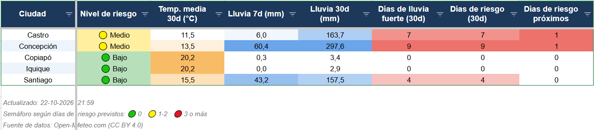

# Clima Chile ETL



Pipeline ETL en Python que consume la API de [Open-Meteo](https://open-meteo.com/), calcula indicadores climáticos con enfoque operativo para cinco ciudades de Chile y acumula el histórico en una base SQLite.

## Qué hace

1. **Extrae** los últimos 30 días y el pronóstico de los próximos 7 para cada ciudad, con timeouts y reintentos.
2. **Transforma** la respuesta en una tabla diaria y calcula indicadores: temperatura media, rango térmico, días de lluvia fuerte, días de viento fuerte y **días de riesgo operativo**.
3. **Carga** los datos en SQLite. La carga es idempotente: ejecutar el pipeline varias veces el mismo día actualiza los registros en vez de duplicarlos.

## Arquitectura


```
clima-chile-etl/
├── config/
│   └── settings.yaml        # ciudades, variables y umbrales
├── src/clima_etl/
│   ├── config.py            # carga y validación de la configuración
│   ├── extract.py           # cliente de la API (timeouts, reintentos)
│   ├── transform.py         # limpieza e indicadores (funciones puras)
│   ├── load.py              # escritura en SQLite
│   ├── logger.py            # logging con hora y nivel
│   ├── pipeline.py          # orquesta extract -> transform -> load
│   ├── __main__.py          # punto de entrada
│   └── sheet.py             # conecta con sheet
├── pyproject.toml
└── requirements.txt
```

## Decisiones de diseño

- **Separación de responsabilidades**: cada módulo hace una sola cosa. Si cambia la API, solo se toca `extract.py`.
- **Configuración fuera del código**: agregar una ciudad o cambiar un umbral es editar `config/settings.yaml`.
- **Funciones puras en `transform.py`**: no dependen de internet ni de archivos, lo que facilita probarlas.
- **Carga idempotente**: clave primaria `(ciudad, fecha)` y `UPSERT`, para poder ejecutar el pipeline sin miedo a duplicar datos.
- **Reintentos selectivos**: se reintenta ante fallas de red y errores 5xx o 429; un error 4xx se informa de inmediato, porque reintentar no lo soluciona.
- **SQLite como fuente de verdad**: acumula el histórico entre ejecuciones y permite consultarlo con SQL.

## Indicadores

| Indicador | Descripción |
|---|---|
| `temp_media`, `rango_termico` | Promedio y diferencia entre máxima y mínima del día |
| `lluvia_fuerte` | Día con lluvia igual o mayor al umbral (por defecto 10 mm) |
| `viento_fuerte` | Día con viento máximo igual o mayor al umbral (por defecto 50 km/h) |
| `riesgo_operativo` | Día con lluvia fuerte o viento fuerte |

Los umbrales se configuran en `config/settings.yaml`. El resumen por ciudad incluye lluvia acumulada a 7 y 30 días, días de riesgo en los últimos 30 días y días de riesgo previstos en el pronóstico.

## Cómo correrlo

Requiere Python 3.10 o superior.

```bash
git clone https://github.com/jescalona-data/clima-chile-etl.git
cd clima-chile-etl

python -m venv .venv
.venv\Scripts\Activate.ps1      # Windows PowerShell

pip install -e .
python -m clima_etl
```

Al terminar se imprime un resumen por ciudad y los datos quedan en `data/clima.db`.

## Ejemplo de salida

Ejecución del 20-10-2026:

```
    ciudad  temp_media_30d  lluvia_7d_mm  lluvia_30d_mm  dias_lluvia_fuerte_30d  dias_riesgo_30d  dias_riesgo_proximos
    Castro            11.2           0.8          176.1                       8                8                     1
Concepción            13.1          10.2          256.4                       8                8                     3
   Copiapó            20.1           0.2            3.5                       0                0                     0
   Iquique            20.0           0.4            4.7                       0                0                     0
  Santiago            15.5           9.9          122.7                       3                3                     1
```

## Consultar la base

```sql
-- Días de riesgo operativo por ciudad en el último mes
SELECT ciudad, COUNT(*) AS dias_riesgo
FROM clima_diario
WHERE tipo = 'historico' AND riesgo_operativo = 1
GROUP BY ciudad
ORDER BY dias_riesgo DESC;
```

## Fuente de datos

Datos meteorológicos de [Open-Meteo.com](https://open-meteo.com/). El uso gratuito de la API es solo para fines no comerciales, y los datos requieren atribución. Este proyecto es de práctica y portfolio; antes de usarlo en un contexto comercial hay que revisar las condiciones de Open-Meteo.

## Roadmap

- [x] Fase 1: extracción, transformación y carga en SQLite
- [x] Fase 2: dashboard en Google Sheets con formato automático
- [ ] Fase 3: tests con `pytest` y ejecución programada